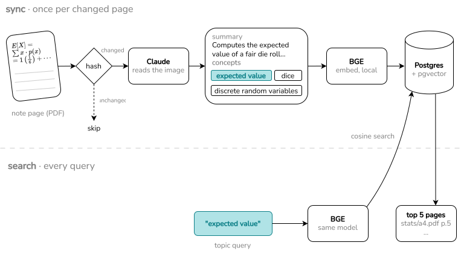

# NoteFinder AI

Search handwritten notes by topic.

NoteFinder indexes handwritten pages exported from GoodNotes as PDFs. Claude reads each page and writes a transcript, a summary, and the concepts the page covers. The summary and concepts are embedded locally and stored in Postgres with pgvector. A query such as `expected value` returns the most relevant pages, even when the page itself only writes `E[X]`.

On 87 pages of CS and math notes, it finds 92% of relevant pages in the top 5 (recall@5), against 66% for keyword search over the transcripts.

## How it works



- **Extraction:** Claude Sonnet 5.5 reads each page image and returns JSON that matches a schema: a transcript, a summary, and a list of concepts.
- **Embedding:** `BAAI/bge-base-en-v1.5`, run locally with sentence-transformers. The embedded text is the summary followed by the concepts.
- **Storage:** one row per page. Each row records what produced it: the image hash, the prompt version (a hash of the prompt text), the Claude model, the embedding model, and the exact text embedded.
- **Retrieval only:** search returns pages (no LLM call).

## Results
I evaluated search on 87 pages of CS and math notes. Before looking at any results, I wrote 30 topic queries and labelled every relevant page for each.

The metric is mean recall@5, with denominator `min(|relevant|, 5)`, so a query with more than five relevant pages can still score 1.0 when the top 5 are all relevant.

| Method | Text searched | Extraction | recall@5 |
|---|---|---|---|
| BM25 (stemmed) | transcript | Sonnet 5.5 | 0.658 |
| BM25 (stemmed) | summary + concepts | Sonnet 5.5 | 0.877 |
| bge-base | summary + concepts | Haiku 5.5 | 0.881 |
| **bge-base** | **summary + concepts** | **Sonnet 5.5** | **0.922** |

### Findings
- **Most of the gain comes from Claude naming the topics.** The same BM25 search improves from 0.66 to 0.88 when it searches Claude's summary and concepts instead of the transcript. The notes often apply topics rather than name them (e.g., a page writes `E[X]`, not "expected value").
- **Embeddings add a smaller gain** (0.88 to 0.92). They may help with synonyms and abbreviations, such as "MSTs" and "dice" vs "die".
- **Sonnet extracts better than Haiku** (0.92 vs 0.88). Haiku more often leaves out the concept an exercise uses.

### Limitations
- **Small sample size**. 30 queries and 87 pages.
- **One extraction per model.** Extraction output varies between runs, so another sync could change a query or two.

## Sync: plan, then apply

One challenge was keeping the database consistent while trying different prompts, models, and notes. Each extraction is a Claude API call, so re-processing every page after each change would be slow and waste money. Sync should redo only the pages a change affects.

**Detecting out-of-date pages.** The inputs that produced each page are stored, like the page image hash. Comparing these against the current inputs tells `sync` what each page needs:

| Change | Action |
|---|---|
| New page, changed image, prompt, or Claude model | Re-extract with Claude, then embed |
| Embedding model or embedded text | Re-embed the stored summary and concepts |
| Page removed from disk | Delete, after confirmation |
| Nothing | Skip |

**Separating the plan from the work.** `sync` first builds a plan: a list of pages, each with an action and a reason. Then it carries the plan out. Deciding what to do is a pure function of stored and current state, so it is unit-tested without a database or API calls. The split also gives:

- **A `--dry-run` option.** It prints the plan and stops.
- **Resumable syncs.** Each page is saved in a single upsert only once it's finished. A page that fails or is interrupted saves nothing, so the next plan picks it up again.
- **A consistency check for eval.** `eval` refuses to run unless the plan is empty.

## Usage

Requires Python 3.14+, Docker, and an Anthropic API key. The notes themselves are not in the repository.

**1. Start the database**

```bash
docker compose up -d
```

**2. Install**

```bash
python -m venv venv && source venv/bin/activate
pip install -e ".[dev]"
export ANTHROPIC_API_KEY=...
export NOTEFINDER_NOTES_DIR=notes
```

**3. Sync your notes**

```bash
notefinder sync --dry-run    # show what would change, and why
notefinder sync              # extract and embed new or changed pages
```

**4. Search**

```console
$ notefinder search "expected value" -k 3
 1  assignment4.pdf  p.6                                         stats/ · 0.66
    Probability exercises: computing the expectation and variance of X+2Y for
    correlated exponential random variables using integration, substitution,
    and covariance.
    ▸ expected value · variance of linear combination · exponential distribution · …

 2  assignment4.pdf  p.5                                         stats/ · 0.63
    Probability notes and worked solution computing a conditional expectation
    E[Y|X=x] from a conditional density using integration by parts, after a
    percentile quadratic root.
    ▸ conditional expectation · conditional probability density · …

 3  assignment4.pdf  p.7                                         stats/ · 0.62
    Probability notes: computing variance and second moments of exponential
    random variables using integration by parts on improper integrals,
    including V[X] and V[2Y].
    ▸ integration by parts · variance · exponential distribution · expected value · …

3 pages · 1444 ms
```

Other commands:

```bash
notefinder shell                    # fast interactive search (<100ms); loads the model once
notefinder eval                     # score recall@5 against eval/labels.yaml
notefinder eval --method bm25       # score the keyword baseline
pytest                              # run the tests against a separate test database
```

## Stack

Python · Postgres + pgvector (Docker Compose) · Anthropic Python SDK · sentence-transformers (BGE) · PyMuPDF · rank-bm25 · Typer · Rich · pytest
